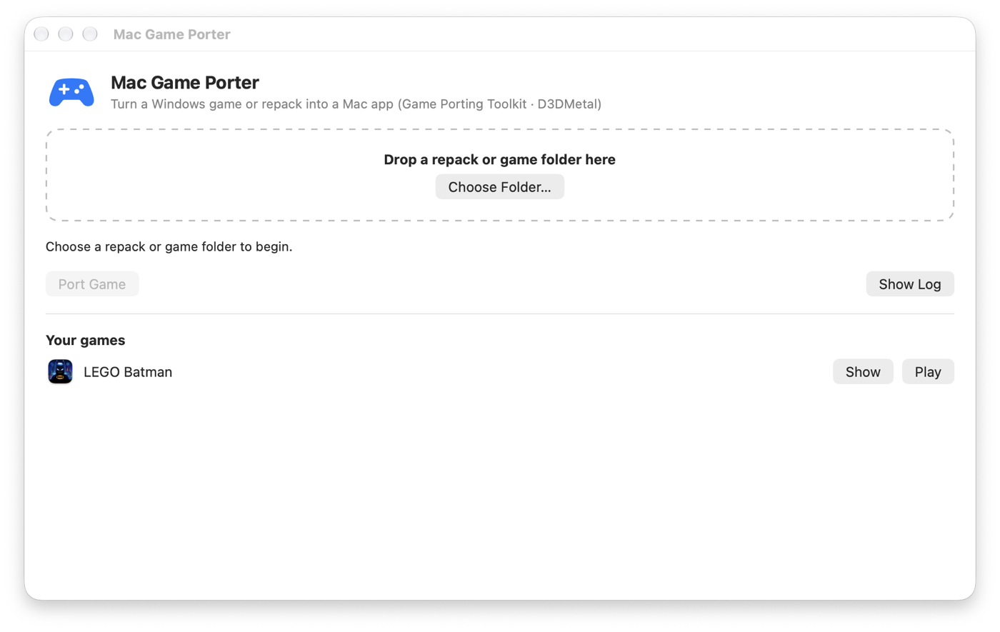

<p align="center"></p>

<h1 align="center">Mac Game Porter</h1>

<p align="center"><b>Play Windows games on your Mac.</b> A free app for Apple Silicon Macs
(M1, M2, M3, M4, M5) that turns Windows games into Mac apps you launch like any other.</p>

<p align="center">
<a href="LICENSE"></a>


<a href="https://github.com/KarmSakha/mac-game-porter/stargazers"></a>
</p>

<p align="center"></p>

## How to play — 4 steps

1. **Download.** Open [Releases](https://github.com/KarmSakha/mac-game-porter/releases) and grab
   `MacGamePorter.dmg`. Open the file, then drag **Mac Game Porter** into the **Applications** folder
   shown in the window.
2. **Open it once.** The first time, right-click (or Control-click) the app → **Open** → **Open**
   again. macOS shows this warning for any free app not paid-signed through Apple — it's safe.
   If there's no Open button, go to System Settings → Privacy & Security → **Open Anyway**.
3. **Port a game.** Drop your game folder onto the window (or click Choose) → check the name →
   press **Port Game**. The first port downloads the Windows game engine automatically — it needs
   internet once, then works offline.
4. **Play.** When it finishes, press **Play**. Your game also lives in `~/Games/<Game>.app` — put it
   in the Dock or open it from Launchpad like any Mac app.

No Terminal, no Homebrew, no Xcode. Everything the app needs is inside it.

## What games can I port?

| You have | Result |
|---|---|
| A **FitGirl-style repack** (`setup.exe` + `.bin` files) | ✅ Unpacked directly on your Mac — no Windows installer needed |
| An **installed Windows game folder** (copied from a PC, external drive, or your Steam library's `steamapps/common/<Game>` folder) | ✅ Works — the app finds the game's `.exe` itself |
| A game that **needs Steam or another launcher running** (Steam DRM / Steamworks) | ❌ Can't start without Steam — there's no Steam client for games under Wine here |
| **Online-only or anti-cheat** games (e.g. Fortnite, Destiny 2, most competitive multiplayer) | ❌ Anti-cheat doesn't run under Wine/GPTK |
| **OpenGL-only** games (no DirectX mode) | ⚠️ May fail to open a window — the graphics stack is built for DirectX |

Best results: **single-player games you already have the files for**. Older and mid-weight games tend
to run great; brand-new releases can be hit-or-miss. If you're unsure, just try it — the app tells
you up front if it can't find a game in the folder.

## Features

- **DirectX 11 and 12 games run on Metal** through Apple's Game Porting Toolkit.
- **Repacks install without the Windows installer** — the app reads the repack's own decoder list
  and unpacks it natively, so installs that stall in CrossOver or Wine just work.
- **One click per game** — each game becomes its own `.app`; optionally export a self-contained
  **DMG** to move it to another Mac.
- **Fits your screen** — borderless fullscreen at your display's exact size.
- **Faster by default** — MetalFX upscaling where games offer DLSS, esync, and sensible graphics
  presets out of the box.
- **Controllers** — PS5 DualSense (with adaptive triggers over USB) and Xbox pads.
- **Gentle on your Mac** — extraction runs at low priority and verifies every file.

## Tested games

| Game | Engine / API | Status |
|---|---|---|
| LEGO Batman: Legacy of the Dark Knight | Unreal Engine 5 · DirectX 12 | ✅ Playable on MacBook Air M5 (installed from a 30 GB FreeArc repack) |
| Cave Story (freeware) | DirectDraw / 2D | ✅ Launches and plays (plain installed-game folder — no repack) |
| Teeworlds | OpenGL | ⚠️ Starts but can't create a GL window — OpenGL-only games are a gap |

Ported another game? Open an issue or PR to add it to this list.

## Mac Game Porter vs. the alternatives

| | Mac Game Porter | CrossOver | Manual Wine / GPTK |
|---|---|---|---|
| Price | Free, open source (MIT) | Paid | Free |
| DirectX 12 via D3DMetal | ✅ | ✅ | ✅ with manual setup |
| Installs FitGirl/FreeArc repacks without running `setup.exe` | ✅ | ❌ | ❌ |
| One `.app` per game, DMG export | ✅ | Partial (bottles) | ❌ |
| Automatic display and fullscreen fixes | ✅ | Partial | ❌ |

## FAQ

### The app "can't be opened" / "unidentified developer"?

That's macOS Gatekeeper warning you about a free, self-signed app. Right-click the app →
**Open** → **Open**. If the dialog has no Open button: System Settings → Privacy & Security →
scroll down → **Open Anyway**. You only do this once per app.

### Which Macs are supported?

Apple Silicon Macs (M1, M2, M3, M4, M5) on macOS 14 Sonoma or later. Intel Macs can't run
D3DMetal, so they're not supported.

### Can I port my Steam games?

You can port the game's **files** — the folder inside `steamapps/common` — but only if the game
doesn't need Steam running to start (no Steam DRM). Many single-player titles work; games that
call back into Steam or ship anti-cheat won't launch. There's no way to run the Steam client
itself inside these ports.

### Will every Windows game work?

No — compatibility is the same as Wine + Game Porting Toolkit generally is. Single-player
DirectX 9–12 games you have complete files for are the sweet spot. Anti-cheat, always-online
and launcher-locked games are out.

### How do I install a FitGirl repack on a Mac?

FitGirl-style repacks ship a Windows `setup.exe` whose unpacker stalls under CrossOver and Wine.
Mac Game Porter skips it entirely and unpacks the `.bin` archives natively. Only install games
you own.

### Is this a free CrossOver or Whisky alternative?

Yes — free, open source, same underlying technology (Wine + Apple's D3DMetal), but one standalone
app per game instead of bottles.

### The game window is too big / overflows fullscreen?

Apps made by Mac Game Porter launch in borderless fullscreen at your screen's exact size, which
fixes the overflowing-window problem common with Wine on Retina displays.

### How do I improve FPS?

Pick DLSS in the game's graphics menu if offered (it maps to Apple MetalFX), lower the preset, or
turn on the Metal HUD (`MTL_HUD_ENABLED=1` in `launch.conf`) to measure.

### Does my PS5 DualSense controller work?

Yes — connect with a USB-C cable for the best support (haptics need USB). Games with native
DualSense support get the real pad, including adaptive triggers; other games see it as an Xbox
controller.

---

## For developers

### Build from source

```sh
git clone https://github.com/KarmSakha/mac-game-porter.git && cd mac-game-porter
brew install innoextract rust mingw-w64 dylibbundler   # dylibbundler bundles innoextract into the app
gui/build.sh && cp -R "build/Mac Game Porter.app" ~/Applications/
```

Requires a full Xcode install selected via `xcode-select` (Command Line Tools alone can miss the
SwiftUI macro plugins and fail with `SwiftUIMacros not found`).

### Command line

```sh
./porter.sh setup                                                 # one-time: runtimes + native helpers
./porter.sh install "~/Downloads/Some Game [Repack]" --name "Some Game" --dmg
open ~/Games/"Some Game.app"
```

### What `install` does

1. **Extracts the repack natively** (`porter/extract.py`). Each archive's solid blocks are streamed
   through their decoder chain with pipes, so intermediate stages never hit the disk. The decoder for
   every method is chosen from the repack itself (`porter/repack.py`):

   | Method source | How it runs on macOS |
   |---|---|
   | `srep` | native arm64 SREP 3.93 (built from FreeArc source) |
   | FreeArc built-ins (`delta`, `dispack070`, `lzma`, `tornado`, …) | native `fa-filter` |
   | `arc.ini` external with `<stdin> <stdout>` | the repack's Windows tool under Wine, piped |
   | `arc.ini` external using temp files (`$$arcpackedfile$$`, `datafile=`) | Windows tool under Wine on temp files |
   | `xtool` / `rtool` (need a seekable input) | intermediate file in, FIFO out |
   | `cls-<name>.dll` plugins (`magic2`, `lolz`, …) | `clshost.exe` loads the plugin under Wine |
   | `4x4:…:<inner>` | blocks decoded in parallel with the inner stage, written in order |

   Every extracted file is checked against the archive's size table. The repack's own `unarc.dll`
   is never used: it deadlocks under Wine on macOS.
2. **Picks the executable**: Unreal (`*/Binaries/Win64/*-Shipping.exe`, skipping the bootstrap exe that
   hangs under Wine), Unity (`X.exe` next to `X_Data/`), otherwise the largest non-installer exe.
   Override with `--exe`.
3. **Builds `~/Games/<Name>.app`** with GPTK Wine and a tuned prefix template. The game data stays in
   `~/Library/Application Support/MacGamePorter/games/<name>`, outside the bundle: macOS's first-launch
   security scan of a 40 GB bundle blocks the launch for minutes. `--dmg` builds a self-contained app
   (game embedded) in a compressed DMG for another Mac.

### What the generated app does on launch

- Copies the prefix to `~/Library/Application Support/<Name>/prefix` on first run, so the app can run
  from a read-only DMG. Saves live there too.
- **Display**: Wine Retina mode off and borderless fullscreen at the exact screen size in points.
  This avoids the "window overflows the screen" problem and exclusive-mode switches macOS can't do.
  Unreal `GameUserSettings.ini` is corrected on every launch; Unity gets `-window-mode borderless`.
- **Performance**: `D3DM_ENABLE_METALFX=1` (DLSS upscaling requests go to MetalFX, where the game offers
  DLSS), esync, and the Unreal first-run Epic preset is lowered to High. Rosetta advertises AVX.
- **Controllers**: Apple's GPTK Wine normally hides a PS5 DualSense behind its XInput converter (a generic
  15-byte pad with no feature or output reports), so games with native DualSense support can't detect it.
  For games that drive Sony pads themselves (detected from the executable, or `--controller raw`) the
  launcher removes that converter from the game's prefix. The game then sees the real DualSense: 64-byte
  reports, calibration features, and output reports for **adaptive triggers**, lightbar and rumble. Other games
  keep XInput mode, where every pad looks like an Xbox controller. Override in `launch.conf` with
  `CONTROLLER=raw` or `CONTROLLER=xinput`. Use a USB-C cable; haptics use the controller's 4-channel USB audio.

Per-user tweaks go in `~/Library/Application Support/<Name>/launch.conf`, for example:

```sh
MTL_HUD_ENABLED=1        # Metal FPS overlay
CONTROLLER=raw           # raw DualSense/DualShock HID (native support, adaptive triggers) or xinput
EXTRA_ARGS="-dx12"       # extra game arguments
```

Logs are written to `~/Library/Application Support/<Name>/last-run.log`.

### Releasing

Push a `v*` tag — `.github/workflows/release.yml` builds the app on a clean macOS runner
(innoextract is built from source with deployment target 14.0 so it runs on macOS 14/15), packages
a DMG + zip, and publishes a GitHub release.

### Requirements

Apple Silicon Mac on macOS 14 or later. To build from source: a full Xcode install plus Homebrew
packages `innoextract rust mingw-w64 dylibbundler` (`native/build.sh` checks for them). Runtimes are
downloaded on first use and verified by SHA-256:
[Wine Staging 11.18](https://github.com/Gcenx/macOS_Wine_builds) for the decoders and
[Game Porting Toolkit 3.0](https://github.com/Gcenx/game-porting-toolkit) for games.
Data and caches live in `~/Library/Application Support/MacGamePorter`.

### Layout

```
porter.sh              entry point
gui/                   SwiftUI app (MacGamePorter.swift), its build script and icon renderer
porter/cli.py          setup / install / extract / package commands
porter/repack.py       repack detection, payload extraction (innoextract), arc.ini → decoder plan
porter/extract.py      streaming extractor and verification
porter/stagerun.py     header / temp-file / 4x4 stage runner
porter/game.py         engine and executable detection
porter/package.py      prefix template, .app and DMG
templates/launcher.sh  launcher copied into every app
native/padtest.c       what a Windows game sees of your controllers (raw HID + XInput), run under Wine
native/dstrigger.c     sends a DualSense adaptive-trigger/lightbar output report to test the output path
native/audiotest.c     lists audio endpoints as Windows games see them (DualSense haptics endpoint)
native/                fa-filter, SREP patch, CLS host, FreeArc archive mapper (vendored, MIT)
```

### Notes

- Nothing proprietary is stored in this repo: Apple's D3DMetal comes with the GPTK download, and
  repack decoders are taken from the repack being installed.
- Only install games you are entitled to.
- The repack's stored checksums use a non-standard format, so verification checks sizes and
  structure, not CRC32.
